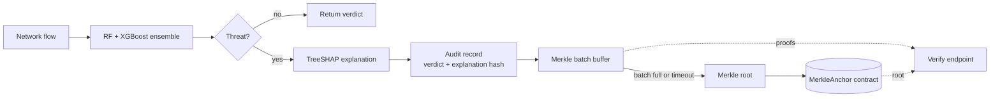

<div align="center">

# 🛡️ ASTRA
### Explainable, Tamper-Evident Network Threat Detection

[](https://python.org)
[](https://fastapi.tiangolo.com)
[](https://ethereum.org)
[](https://scikit-learn.org)
[](#2-explainable-detection)
[](#tests--benchmarks)
[](LICENSE)


ASTRA classifies network flows with a Random Forest + XGBoost ensemble, **explains every decision**,
and keeps a **cryptographically verifiable audit trail** on an Ethereum-compatible blockchain
at ~99% lower gas cost than naive per-record logging.

</div>

---

## Table of Contents
- [Highlights](#highlights)
- [How It Works](#how-it-works)
- [Novel Contributions](#novel-contributions)
- [Audit Logging Modes](#audit-logging-modes)
- [Threat Detection](#threat-detection)
- [API Endpoints](#api-endpoints)
- [Quick Start](#quick-start)
- [Demo: Detect, Explain, Verify, Tamper](#demo-detect-explain-verify-tamper)
- [Docker Deployment](#docker-deployment)
- [Environment Variables](#environment-variables)
- [Tests & Benchmarks](#tests--benchmarks)
- [Project Structure](#project-structure)
- [Known Limitations](#known-limitations)

---

## Highlights

| | Feature | Details |
|---|---|---|
| 🤖 | **Dual ML ensemble** | Random Forest + XGBoost, with per-model confidence and a combined verdict |
| 🔍 | **Explainable decisions** | Exact TreeSHAP feature contributions for every prediction (`/predict/explain`) |
| 🌳 | **Merkle-batched audit log** | Only a 32-byte root per batch goes on-chain; any record is provable with a short proof |
| ⛓️ | **Tamper-evident** | Edit one field of a stored record and verification fails, locally and inside the smart contract |
| 📉 | **~99% less gas** | 281,739 → 1,550 gas per record at batch size 50 (measured) |
| 📊 | **Honest evaluation tooling** | Cross-dataset + robustness script that refuses to inflate results |
| 📦 | **Batch processing** | JSON (up to 1,000 flows) and CSV upload (up to 5,000 rows) |
| 🔒 | **Production-minded** | CORS control, structured logging, Docker, 42 automated tests |

---

## How It Works


The audit path in Merkle mode:



---

## Novel Contributions

ASTRA goes beyond "classifier + blockchain log" with three research-oriented additions.

### 1. Merkle-batched, tamper-evident audit logging
Writing every threat on-chain is expensive. ASTRA hashes records into a **Merkle tree** off-chain and anchors only the **root** of each batch in the `MerkleAnchor` smart contract. Any single record can later be proven with a logarithmic-size proof, checked both in Python and by the contract's own `verify()`.

Measured on an in-memory EVM with 500 identical threat records (`python scripts/benchmark_gas.py`):

| Mode | Batch size | Gas / record | Reduction |
|---|---|---|---|
| Per-record (`ThreatLog`) | 1 | 281,739 | — |
| Merkle (`MerkleAnchor`) | 10 | 7,611 | 97.3% |
| Merkle (`MerkleAnchor`) | 50 | 1,550 | 99.5% |
| Merkle (`MerkleAnchor`) | 500 | 186 | 99.9% |


**Trade-off:** records are buffered until a batch fills (or `MERKLE_FLUSH_SECONDS` passes), so anchoring is delayed. Raw records live in an off-chain append-only journal (`data/merkle_journal.jsonl`); the chain guarantees their *integrity* rather than storing them.

### 2. Explainable detection
`POST /api/v1/predict/explain` returns the verdict **and why**: exact TreeSHAP contributions from XGBoost (`pred_contribs`, no extra dependency). The explanation is faithful by construction: summed contributions reproduce `predict_proba` exactly (unit-tested). Its keccak256 hash is committed inside the audit record, so the tamper-evident log also proves *why* a decision was made. The dashboard renders the top features as signed bars.

### 3. Generalization & robustness evaluation
`scripts/evaluate.py` evaluates the saved models on another CICFlowMeter dataset (e.g. CSE-CIC-IDS2018) with per-class metrics, confusion matrices and robustness curves under evasion-like perturbations (raw-space jitter, Gaussian noise, feature masking). It excludes and counts unsupported labels, and refuses to run when too many features are missing, so reported numbers are never silently inflated.

```bash
python scripts/evaluate.py --csv path/to/dataset.csv --name cic2018 --robustness
```

> Cross-dataset results depend on the data you run it on and are **not included** in this repository. The script writes `docs/evaluation/<name>/report.md`.

---

## Audit Logging Modes

Choose with `LOGGING_MODE` in `.env`.

| | `per_record` (default) | `merkle` |
|---|---|---|
| On-chain writes | One transaction per threat | One transaction per batch (root only) |
| Gas per record | ~281,739 | ~1,550 at batch size 50 |
| Visible on-chain | Immediately, full record | After batch seals, root only |
| Dashboard "Blockchain Records" table | ✅ Populated | ❌ Not populated (use the `/blockchain/merkle/*` endpoints) |
| Integrity proof | Record is stored on-chain | Merkle proof against the anchored root |
| Contract needed | `ThreatLog` | `MerkleAnchor` |
| Best for | Small deployments, live demos of the dashboard | High alert volume, cost-sensitive setups, research |

`per_record` is the default so existing setups and the dashboard behave exactly as before. Switch to `merkle` when you want the gas savings and verifiable proofs. Check the active mode any time via `GET /api/v1/blockchain/status`.

---

## Threat Detection

ASTRA uses **51 CICFlowMeter features**. The shipped model predicts these classes:

| Threat | Severity | Automated response |
|---|---|---|
| ✅ Benign | None | No action required |
| 🔴 DDoS | Critical | Activate DDoS mitigation. Rate-limit source. Alert NOC. |
| 🔴 DoS | Critical | Rate-limit traffic. Block offending IP. Alert security team. |
| 🟠 BruteForce | High | Block source IP. Enable account lockout policy. |
| 🟡 PortScan | Medium | Flag source IP for monitoring. Review firewall rules. |

> **Infiltration** has a response mapping in the code (High: isolate system, forensic analysis), but the shipped label encoder contains no Infiltration class, so the current model never predicts it. See [Known Limitations](#known-limitations).

---

## API Endpoints

Interactive docs: **http://localhost:8000/docs**

**Detection**

| Method | Endpoint | Description |
|---|---|---|
| `GET` | `/api/v1/health` | System health (models + blockchain) |
| `POST` | `/api/v1/predict` | Analyze a single flow |
| `POST` | `/api/v1/predict/explain` | Analyze a flow + TreeSHAP explanation (`?top_k=8`) |
| `POST` | `/api/v1/predict/batch` | Analyze up to 1,000 flows (JSON) |
| `POST` | `/api/v1/predict/csv` | Analyze up to 5,000 flows (CSV upload) |

**Blockchain audit**

| Method | Endpoint | Description |
|---|---|---|
| `GET` | `/api/v1/blockchain/status` | Connection status, active logging mode |
| `GET` | `/api/v1/blockchain/logs` | All on-chain records (`per_record` mode) |
| `GET` | `/api/v1/blockchain/logs/{id}` | Single on-chain record |
| `GET` | `/api/v1/blockchain/merkle/stats` | Batching stats, average gas per record |
| `GET` | `/api/v1/blockchain/merkle/batches` | Sealed batches and anchoring status |
| `POST` | `/api/v1/blockchain/merkle/flush` | Seal pending records and anchor now |
| `GET` | `/api/v1/blockchain/merkle/proof/{id}` | Merkle proof for one audit record |
| `POST` | `/api/v1/blockchain/merkle/verify` | Verify a record locally and in the smart contract |

The `merkle/*` endpoints return `409` unless `LOGGING_MODE=merkle`.

---

## Quick Start

**Prerequisites:** Python 3.11+, and optionally [Ganache](https://trufflesuite.com/ganache/) for the blockchain features.

```bash
# 1. Clone & install
git clone https://github.com/MHanzala74/ASTRA-Cyber-Threat-Detection.git
cd ASTRA-Cyber-Threat-Detection
python -m venv .venv
source .venv/bin/activate        # Windows: .venv\Scripts\activate
pip install -r requirements.txt

# 2. Configure
cp .env.example .env

# 3. (Optional) deploy contracts — start Ganache first: ganache --port 8545
python deploy_contract.py        # prints CONTRACT_ADDRESS and MERKLE_CONTRACT_ADDRESS
# paste both into .env, and set LOGGING_MODE=merkle if you want batching

# 4. Run
python startup.py
```

The API runs without Ganache; blockchain logging is simply disabled and `/health` reports it.

Open the dashboard by opening `ui/astra_dashboard_1.html` in a browser (API must be running).

---

## Demo: Detect, Explain, Verify, Tamper

Requires `LOGGING_MODE=merkle` and a deployed `MerkleAnchor`. Use any valid flow payload (missing features default to 0; see `/docs` for the full schema).

```bash
# 1) Detect + explain: returns verdict, top SHAP features, explanation_hash, audit_record_id
curl -s -X POST "http://localhost:8000/api/v1/predict/explain?top_k=5" \
     -H "Content-Type: application/json" -d @flow.json

# 2) Seal the pending batch and anchor its Merkle root on-chain
curl -s -X POST http://localhost:8000/api/v1/blockchain/merkle/flush

# 3) Fetch the proof for the record (use the audit_record_id from step 1)
curl -s http://localhost:8000/api/v1/blockchain/merkle/proof/0

# 4) Verify the untouched record  ->  valid_local: true, valid_onchain: true
curl -s -X POST http://localhost:8000/api/v1/blockchain/merkle/verify \
     -H "Content-Type: application/json" \
     -d '{"record_id": 0, "record": { ...record from step 3... }}'

# 5) Tamper: change any field (e.g. "severity": "none") and verify again
#    ->  valid_local: false, valid_onchain: false
```

---

## Docker Deployment

```bash
docker compose up --build        # API + Ganache
docker compose up -d --build     # in background
docker compose logs -f astra
docker compose down
```

---

## Environment Variables

Copy `.env.example` to `.env`:

| Variable | Default | Description |
|---|---|---|
| `APP_ENV` | `development` | `development` or `production` |
| `APP_HOST` | `0.0.0.0` | Server bind address |
| `APP_PORT` | `8000` | Server port |
| `APP_WORKERS` | `1` | Uvicorn worker processes |
| `ALLOWED_ORIGINS` | `http://localhost:3000` | Comma-separated CORS origins |
| `GANACHE_URL` | `http://127.0.0.1:8545` | Ethereum node URL |
| `CONTRACT_ADDRESS` | *(empty)* | Deployed `ThreatLog` address |
| `MERKLE_CONTRACT_ADDRESS` | *(empty)* | Deployed `MerkleAnchor` address |
| `LOGGING_MODE` | `per_record` | `per_record` or `merkle` |
| `MERKLE_BATCH_SIZE` | `50` | Records per Merkle batch |
| `MERKLE_FLUSH_SECONDS` | `30` | Seal a partial batch after N seconds |
| `MERKLE_STORE_PATH` | `data/merkle_journal.jsonl` | Off-chain audit journal |
| `LOG_LEVEL` | `INFO` | `DEBUG / INFO / WARNING / ERROR` |
| `LOG_FILE` | *(empty)* | Log file path (empty = console only) |

> Never commit `.env` or any access token. Use `.env.example` as the template.

---

## Tests & Benchmarks

```bash
pip install -r requirements-dev.txt
pytest -q                          # 42 tests: Merkle logic, contract verification,
                                   # explainability, evaluation pipeline, end-to-end API
python scripts/benchmark_gas.py    # per-record vs Merkle gas comparison -> docs/
```

The end-to-end tests run the real FastAPI app and models against an in-memory EVM, so no Ganache is needed.

---

## Project Structure

```
ASTRA/
├── app/
│   ├── main.py              # FastAPI app, middleware, lifespan (+ Merkle flush task)
│   ├── config.py            # Settings from env vars
│   ├── models.py            # ML model singleton + feature list
│   ├── schemas.py           # Pydantic request/response models
│   ├── blockchain.py        # Web3 integration (ThreatLog + MerkleAnchor)
│   ├── merkle.py            # Merkle tree, proofs, persistent batcher
│   ├── event_logger.py      # per_record / merkle logging dispatcher
│   ├── explain.py           # TreeSHAP explanations + explanation hash
│   └── routers/             # health, predict, batch, blockchain_router
├── artifacts/               # rf / xgb models, scaler, label encoder
├── build/contracts/         # Compiled ABI + bytecode (solc 0.8.19)
├── contracts: ThreatLog.sol, MerkleAnchor.sol
├── scripts/
│   ├── benchmark_gas.py     # Gas benchmark
│   └── evaluate.py          # Cross-dataset + robustness evaluation
├── tests/                   # pytest suite
├── ui/astra_dashboard_1.html
├── docs/                    # architecture diagram, gas benchmark
├── deploy_contract.py       # Deploys both contracts
├── startup.py               # Uvicorn entry point
├── Dockerfile / docker-compose.yml
├── requirements.txt / requirements-dev.txt
└── .env.example
```

---

## Known Limitations

- **Class coverage:** the saved label encoder has 5 classes (no Infiltration). Retrain with Infiltration data to enable it.
- **Library versions:** the model files were serialized with scikit-learn 1.8.0 while `requirements.txt` pins 1.5.2. Predictions matched in our check, but loading emits a version warning; re-export the models or align the pin for production.
- **Explanations cover XGBoost only.** The ensemble verdict is explained through the XGBoost model's TreeSHAP values; the Random Forest is not explained.
- **Merkle mode delays anchoring** until a batch seals, and the off-chain journal must be backed up: the chain proves integrity but does not store the records.
- **Cross-dataset performance is unreported** until `scripts/evaluate.py` is run on the target datasets.
- **Dashboard:** the "Blockchain Records" table reads the per-record `ThreatLog` contract only.
