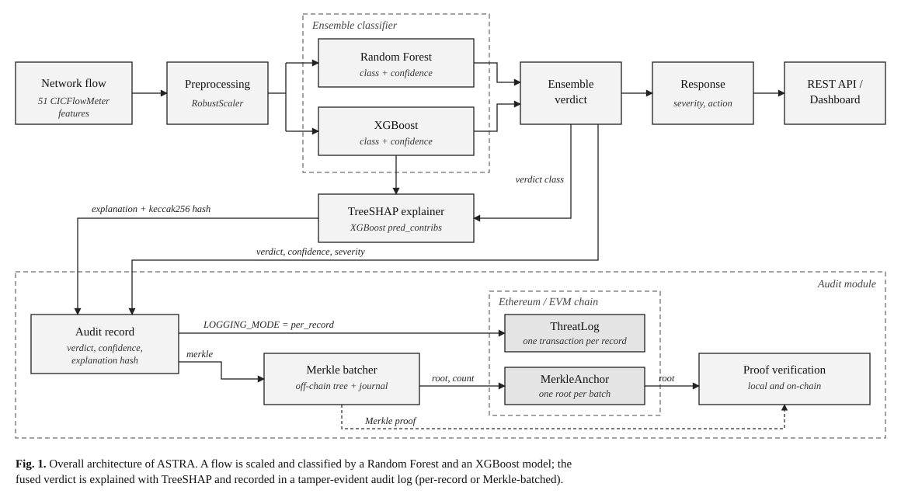
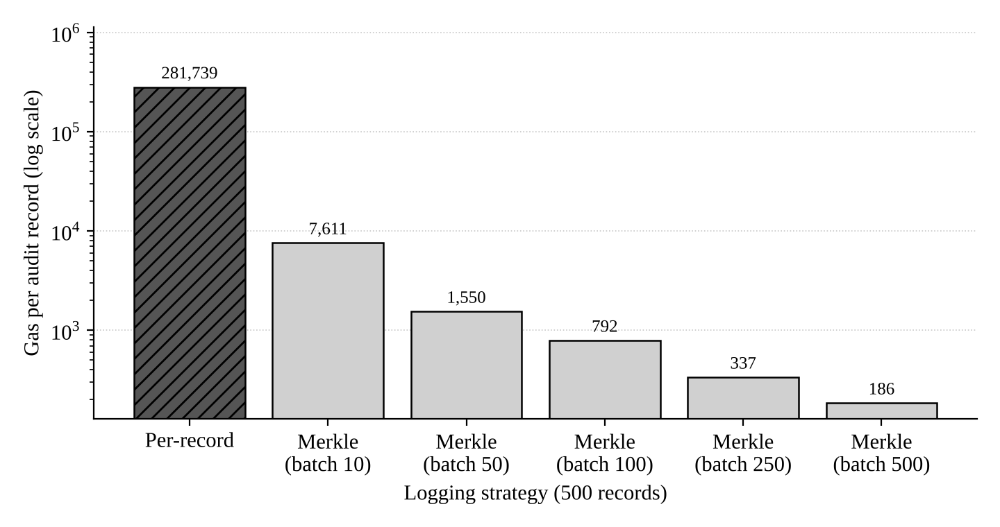

<div align="center">

# ASTRA
### AI-Based Cyber Threat Detection and Response System with Blockchain Audit Logging

[](https://python.org)
[](https://fastapi.tiangolo.com)
[](https://scikit-learn.org)
[](https://xgboost.ai)
[](https://soliditylang.org)
[](#testing)
[](LICENSE)


</div>

---

## Table of Contents

1. [Overview](#overview)
2. [Features](#features)
3. [System Architecture](#system-architecture)
4. [Audit Log Cost Evaluation](#audit-log-cost-evaluation)
5. [Detected Threat Classes](#detected-threat-classes)
6. [Installation](#installation)
7. [Usage](#usage)
8. [Configuration](#configuration)
9. [Docker Deployment](#docker-deployment)
10. [Testing](#testing)
11. [Project Structure](#project-structure)
12. [Limitations](#limitations)
13. [License](#license)

---

## Overview

ASTRA is a network intrusion detection system that classifies network flows into benign traffic and several attack categories using an ensemble of a Random Forest and an XGBoost model trained on CICFlowMeter flow features. Each detection is returned with a severity level and a recommended response, can be accompanied by a feature-level explanation, and is recorded in an audit log anchored on an Ethereum-compatible blockchain so that stored detections cannot be altered without detection.

The system is exposed as a REST API (FastAPI) with a browser dashboard, and ships with Solidity smart contracts, deployment tooling, an automated test suite and benchmarking scripts.

## Features

- **Ensemble detection.** Random Forest and XGBoost classifiers over 51 flow features, with per-model confidence and a fused verdict.
- **Response recommendation.** Every verdict maps to a severity level and an operator action.
- **Explainable predictions.** Exact TreeSHAP feature contributions from XGBoost (`/predict/explain`), shown in the dashboard.
- **Blockchain audit log.** Detections are written to a smart contract either one record per transaction or in Merkle-tree batches.
- **Verifiable records.** In Merkle mode any stored record can be checked against the on-chain root with a short proof, both locally and by the contract itself.
- **Batch analysis.** JSON batches of up to 1,000 flows and CSV uploads of up to 5,000 rows.
- **Evaluation tooling.** A script for cross-dataset evaluation and robustness testing of the saved models.
- **Operations.** Environment-based configuration, CORS control, structured logging and a Docker setup.

## System Architecture

<p align="center">
  
</p>

### Detection pipeline

An incoming flow of 51 CICFlowMeter features is scaled with a `RobustScaler` and passed to the Random Forest and XGBoost classifiers. Their outputs are fused into a single verdict, which is mapped to a severity level and a recommended action and returned by the API.

### Explainability

For the `/predict/explain` endpoint, ASTRA computes exact TreeSHAP values with XGBoost's built-in `pred_contribs`. For the explained class, the contributions plus the base value equal the model's margin, and a softmax over the per-class margins reproduces `predict_proba` (verified in the test suite). The canonical explanation is hashed with keccak256 and the hash is stored in the audit record.

### Audit logging

Detections flagged as threats are passed to the audit module, which operates in one of two modes selected by `LOGGING_MODE`:

| | `per_record` (default) | `merkle` |
|---|---|---|
| Contract | `ThreatLog` | `MerkleAnchor` |
| On-chain writes | One transaction per threat | One transaction per batch (Merkle root only) |
| Stored on-chain | Full record | 32-byte root and record count |
| Stored off-chain | None | Append-only journal (`data/merkle_journal.jsonl`) |
| Integrity check | Read the record from the chain | Merkle proof verified against the anchored root |
| Latency to chain | Immediate | Until a batch fills or `MERKLE_FLUSH_SECONDS` elapses |
| Dashboard "Blockchain Records" table | Populated | Not populated (use `/blockchain/merkle/*`) |

In Merkle mode, records are canonicalised and hashed into leaves (`keccak256(0x00 ‖ canonical_json)`), combined pairwise with sorted-pair hashing, and only the root of each batch is anchored. `MerkleAnchor.verify` recomputes the root from a leaf and its proof inside the contract. `per_record` is the default so that the dashboard and existing deployments behave as before. The active mode is reported by `GET /api/v1/blockchain/status`.

## Audit Log Cost Evaluation

Gas cost was measured by logging 500 identical threat records through each contract on an in-memory EVM (`scripts/benchmark_gas.py`).

<p align="center">
  
</p>

**Fig. 2.** Gas per audit record for per-record logging and for Merkle batching at different batch sizes (log scale).

| Strategy | Batch size | Transactions | Gas / record | Reduction |
|---|---|---|---|---|
| Per-record (`ThreatLog`) | 1 | 500 | 281,739 | n/a |
| Merkle (`MerkleAnchor`) | 10 | 50 | 7,611 | 97.3% |
| Merkle (`MerkleAnchor`) | 50 | 10 | 1,550 | 99.5% |
| Merkle (`MerkleAnchor`) | 100 | 5 | 792 | 99.7% |
| Merkle (`MerkleAnchor`) | 250 | 2 | 337 | 99.9% |
| Merkle (`MerkleAnchor`) | 500 | 1 | 186 | 99.9% |

The savings come from storing one 32-byte root per batch instead of the full record, at the cost of delayed anchoring and of keeping the raw records off-chain. Gas figures come from an in-memory EVM and are exact for the executed bytecode; actual network fees additionally depend on the gas price.

`scripts/evaluate.py` evaluates the saved models on another CICFlowMeter-format dataset (for example CSE-CIC-IDS2018) and writes per-class metrics, confusion matrices and robustness curves (multiplicative feature jitter, Gaussian noise, random feature masking) to `docs/evaluation/<name>/`. Cross-dataset results are not included in this repository.

```bash
python scripts/evaluate.py --csv path/to/dataset.csv --name cic2018 --robustness
```

## Detected Threat Classes

The shipped model predicts the following classes from 51 CICFlowMeter features.

| Class | Severity | Recommended response |
|---|---|---|
| Benign | None | No action required. |
| DDoS | Critical | Activate DDoS mitigation. Rate-limit source. Alert NOC. |
| DoS | Critical | Rate-limit traffic. Block offending IP. Alert security team. |
| BruteForce | High | Block source IP. Enable account lockout policy. |
| PortScan | Medium | Flag source IP for monitoring. Review firewall rules. |

The code also defines a response for an `infiltration` class, but the shipped label encoder does not contain it, so the current model never predicts it (see [Limitations](#limitations)).

## Installation

**Requirements:** Python 3.11 or newer. [Ganache](https://trufflesuite.com/ganache/) (or any EVM node) is optional and only needed for blockchain logging.

```bash
git clone https://github.com/MHanzala74/ASTRA-Cyber-Threat-Detection.git
cd ASTRA-Cyber-Threat-Detection

python -m venv .venv
source .venv/bin/activate          # Windows: .venv\Scripts\activate
pip install -r requirements.txt

cp .env.example .env
```

**Deploy the contracts (optional).** Start a local node (`ganache --port 8545`), then:

```bash
python deploy_contract.py
```

The script deploys `ThreatLog` and `MerkleAnchor` from the compiled artifacts in `build/contracts/` and prints their addresses. Add them to `.env` as `CONTRACT_ADDRESS` and `MERKLE_CONTRACT_ADDRESS`, and set `LOGGING_MODE=merkle` to use Merkle batching.

**Run the API:**

```bash
python startup.py
```

The API listens on `http://localhost:8000` (interactive documentation at `/docs`). It runs without a blockchain node; logging is then disabled and reported by `/api/v1/health`. To use the dashboard, open `ui/astra_dashboard_1.html` in a browser while the API is running.

## Usage

### API endpoints

All endpoints are prefixed with `/api/v1`.

**Detection**

| Method | Endpoint | Description |
|---|---|---|
| `GET` | `/health` | Service health (models, blockchain) |
| `POST` | `/predict` | Classify a single flow |
| `POST` | `/predict/explain` | Classify a flow and return TreeSHAP feature contributions (`?top_k=8`) |
| `POST` | `/predict/batch` | Classify up to 1,000 flows (JSON) |
| `POST` | `/predict/csv` | Classify up to 5,000 flows (CSV upload) |

**Blockchain audit**

| Method | Endpoint | Description |
|---|---|---|
| `GET` | `/blockchain/status` | Connection state and active logging mode |
| `GET` | `/blockchain/logs` | All on-chain records (`per_record` mode) |
| `GET` | `/blockchain/logs/{id}` | A single on-chain record |
| `GET` | `/blockchain/merkle/stats` | Batching statistics and average gas per record |
| `GET` | `/blockchain/merkle/batches` | Sealed batches and their anchoring status |
| `POST` | `/blockchain/merkle/flush` | Seal pending records and anchor their root |
| `GET` | `/blockchain/merkle/proof/{id}` | Record, leaf hash, Merkle proof and root |
| `POST` | `/blockchain/merkle/verify` | Verify a submitted record locally and in the contract |

The `merkle/*` endpoints return `409` unless `LOGGING_MODE=merkle`. Missing flow features default to `0`; the full request schema is available at `/docs`.

### Example: detect, verify, and detect tampering

With `LOGGING_MODE=merkle` and a deployed `MerkleAnchor`:

```bash
# 1. Classify and explain a flow (flow.json holds the 51 features).
#    The response includes explanation_hash and audit_record_id for threats.
curl -s -X POST "http://localhost:8000/api/v1/predict/explain?top_k=5" \
     -H "Content-Type: application/json" -d @flow.json

# 2. Seal the pending batch and anchor its root on-chain.
curl -s -X POST http://localhost:8000/api/v1/blockchain/merkle/flush

# 3. Retrieve the proof for the record.
curl -s http://localhost:8000/api/v1/blockchain/merkle/proof/0

# 4. Verify the unmodified record: valid_local and valid_onchain are true.
curl -s -X POST http://localhost:8000/api/v1/blockchain/merkle/verify \
     -H "Content-Type: application/json" \
     -d '{"record_id": 0, "record": { ...record returned in step 3... }}'

# 5. Change any field of the record (e.g. "severity") and repeat step 4:
#    both checks now return false.
```

## Configuration

Settings are read from environment variables (see `.env.example`).

| Variable | Default | Description |
|---|---|---|
| `APP_ENV` | `development` | `development` or `production` |
| `APP_HOST` | `0.0.0.0` | Bind address |
| `APP_PORT` | `8000` | Port |
| `APP_WORKERS` | `1` | Uvicorn worker processes |
| `ALLOWED_ORIGINS` | `http://localhost:3000` | Comma-separated CORS origins |
| `GANACHE_URL` | `http://127.0.0.1:8545` | Ethereum node URL |
| `CONTRACT_ADDRESS` | empty | Deployed `ThreatLog` address |
| `MERKLE_CONTRACT_ADDRESS` | empty | Deployed `MerkleAnchor` address |
| `LOGGING_MODE` | `per_record` | `per_record` or `merkle` |
| `MERKLE_BATCH_SIZE` | `50` | Records per Merkle batch |
| `MERKLE_FLUSH_SECONDS` | `30` | Seal a partial batch after this many seconds |
| `MERKLE_STORE_PATH` | `data/merkle_journal.jsonl` | Off-chain audit journal |
| `LOG_LEVEL` | `INFO` | `DEBUG`, `INFO`, `WARNING` or `ERROR` |
| `LOG_FILE` | empty | Log file path (empty: console only) |

Do not commit `.env` or any access tokens.

## Docker Deployment

```bash
docker compose up --build          # API and Ganache
docker compose up -d --build       # detached
docker compose logs -f astra
docker compose down
```

## Testing

```bash
pip install -r requirements-dev.txt
pytest -q
python scripts/benchmark_gas.py
```

The 42 tests cover Merkle tree construction and proofs, verification of Python-generated proofs inside the Solidity contract, the faithfulness of the TreeSHAP explanations, the evaluation pipeline, and end-to-end API behaviour including tamper detection. They run against an in-memory EVM, so no external node is required. The evaluation-pipeline tests use synthetic data and check the code path, not detection accuracy.

## Project Structure

```
.
├── app/
│   ├── main.py                 # FastAPI application and lifespan tasks
│   ├── config.py               # Environment-based settings
│   ├── models.py               # Model loading and feature list
│   ├── schemas.py              # Request and response models
│   ├── blockchain.py           # Web3 integration (ThreatLog, MerkleAnchor)
│   ├── merkle.py               # Merkle tree, proofs, persistent batcher
│   ├── event_logger.py         # per_record / merkle logging dispatcher
│   ├── explain.py              # TreeSHAP explanations and hashing
│   └── routers/                # health, predict, batch, blockchain
├── artifacts/                  # Trained models, scaler, label encoder
├── build/contracts/            # Compiled ABI and bytecode (solc 0.8.19)
├── ThreatLog.sol               # Per-record logging contract
├── MerkleAnchor.sol            # Merkle-root anchoring contract
├── scripts/
│   ├── benchmark_gas.py        # Gas benchmark
│   └── evaluate.py             # Cross-dataset and robustness evaluation
├── tests/                      # pytest suite
├── ui/astra_dashboard_1.html   # Browser dashboard
├── docs/                       # Figures and benchmark results
├── deploy_contract.py          # Contract deployment
├── startup.py                  # Server entry point
├── Dockerfile, docker-compose.yml
├── requirements.txt, requirements-dev.txt
└── .env.example
```

## Limitations

- The saved label encoder has five classes and no Infiltration class; the model cannot predict it until retrained with such data.
- The model files were serialised with scikit-learn 1.8.0 while `requirements.txt` pins 1.5.2. Predictions matched in our check, but loading emits a version warning; align the pin or re-export the models before production use.
- Explanations are computed from the XGBoost model only; the Random Forest is not explained.
- In Merkle mode, anchoring is delayed until a batch is sealed, and the off-chain journal must be backed up: the chain proves integrity but does not store the records.
- Generalisation to other datasets has not been measured here; run `scripts/evaluate.py` on the target data.
- The dashboard's "Blockchain Records" table reads only the per-record `ThreatLog` contract.

## License

Distributed under the MIT License. See [LICENSE](LICENSE).
